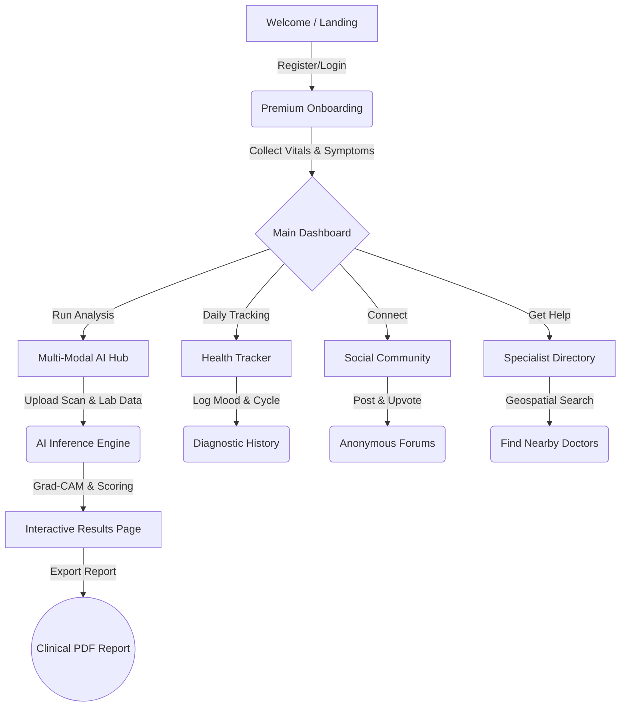

# SHEra: AI-Powered PCOS/PCOD Healthcare Platform 🌸

<div align="center">
  <p><strong>Early Detection • Multi-Modal AI Fusion • Automatic Image Validation • Smart Tracking • Supportive Community • Medical Guidance</strong></p>
</div>

SHEra is a comprehensive, next-generation healthcare platform designed to assist women in the early detection, tracking, and ongoing management of **Polycystic Ovary Syndrome (PCOS)** and **Polycystic Ovarian Disease (PCOD)**.

Built with a premium, modern, and calming UI, SHEra bridges the gap between daily health tracking and advanced medical diagnostics, bringing professional-grade AI analysis directly to users in a safe, secure, and user-friendly environment.

---

## 🌟 The Problem & The Solution

**The Problem:** PCOS affects up to 10-15% of women worldwide, yet it remains significantly underdiagnosed. Many women struggle with fragmented health tracking apps, delayed diagnoses, and lack of access to specialized medical advice. 

**The Solution:** SHEra consolidates the entire ecosystem of women's reproductive health into a single platform. It uses dual-model Artificial Intelligence (Clinical + Imaging) to provide a highly accurate preliminary risk assessment, while offering daily tracking and community support to help manage the condition long-term.

---

## 💻 Tech Stack

**Frontend:**  


**Backend:**  


**AI & Machine Learning:**  


---

## ✨ Core Features & Modules

### 1. 🤖 Multi-Modal AI Diagnostic Hub
The heart of SHEra is its proprietary AI engine. It evaluates both clinical history and medical imaging simultaneously.
*   **Clinical Analysis (Tabular Random Forest):** Evaluates a 41-feature clinical matrix.
*   **Symptom Mapping:** Tracks physical symptoms (acne, hair loss, hirsutism, weight gain) and cycle regularity.
*   **Hormonal Metrics:** Evaluates hormonal balances (FSH, LH, AMH).
*   **Vitals:** Incorporates blood pressure, glucose, and body metrics (BMI, Waist:Hip Ratio).
*   **Lab Report Integration:** Users can optionally input exact clinical lab metrics. Unprovided or missing features are passed as `NaN` and dynamically imputed at inference time using the scikit-learn `Pipeline` and `SimpleImputer(strategy='median')` learned strictly from the training distribution, preventing data leakage and handling sparse inputs.
*   **Ultrasound Analysis (CNN):** A deep Convolutional Neural Network visually inspects pelvic ultrasound scans for characteristic follicle textures and patterns.
*   **Heuristic Multi-Modal Fusion Scoring:** Merges outputs (`Clinical Data 60%` + `Visual Scan 40%`) when an ultrasound scan is provided, or evaluates at 100% clinical weighting if omitted. *Note:* This 60/40 weighting is a domain-inspired heuristic; the clinical CSV and ultrasound images originate from completely independent patient cohorts, meaning fusion weights cannot be validated or learned end-to-end.
*   **Severity-Tiered Risk Levels:** Classifies screening outputs into non-diagnostic risk categories (`Higher risk - consult a doctor`, `Moderate risk`, `Low risk - monitor`, `Minimal risk`).

### 2. 🔍 Explainable AI & Trust
We believe AI in healthcare must be transparent.
*   **Grad-CAM Heatmaps:** Generates a visual heatmap overlay on ultrasound uploads targeting the probability of PCOS findings.
*   **Visual Localization:** Highlights which regions of the ultrasound (e.g., specific peripheral follicle clusters) triggered the AI's detection.
*   **Confidence Scoring:** Provides an exact confidence percentage and clinical severity level.

### 3. 🛡️ Smart Ultrasound Image Guardrail
A built-in rule-based safety mechanism to screen uploaded images.
*   **Grayscale Dominance Check:** Evaluates color saturation (threshold ≤ 0.18) to reject colorful photos (like selfies, documents).
*   **Background Ratio Check:** Evaluates pixel darkness (threshold ≥ 0.10) to confirm typical ultrasound dark acoustic backgrounds.
*   **Guardrail Limitations:** Because this safety filter is rule-based, it can reject valid scans (e.g., contrast-enhanced or color Doppler scans) or accept non-ultrasound grayscale images (e.g., grayscale photos or sketches). Real-time API feedback is returned if an upload is rejected.

### 4. 📝 Premium Clinical Onboarding
A beautiful, interactive profile builder that creates a complete health baseline.
*   **Demographics:** Age, height, weight (with automated BMI calculation).
*   **Medical History:** Past conditions, pregnancy history.
*   **Lifestyle Assessment:** Diet, exercise, and stress levels.
*   **Symptom Check:** Detailed toggles for irregular cycles, hair loss, skin darkening, etc.

### 5. 📄 Exportable Clinical PDF Reports
Take your data to your doctor.
*   **Instant PDF Generation:** Converts the AI risk assessment into a branded, print-ready document.
*   **Comprehensive Summary:** Includes the risk score, patient demographics, and actionable next steps.
*   **Dynamic Binding:** Automatically fetches the user's name, age, and test timestamp.

### 6. 📊 Interactive Health Tracker
A daily digital diary tailored for reproductive health.
*   **Cycle Tracking:** Log menstrual cycle dates with intelligent future predictions.
*   **Mood Logging:** Tag daily moods using a responsive emoji selector.
*   **Symptom Flare-ups:** Record daily symptoms to track patterns over time.
*   **Diagnostic History:** Securely saves all past AI evaluations to track your risk trajectory.

### 7. 💬 Anonymous Social Community
A built-in supportive forum.
*   **Share & Connect:** Share personal experiences, ask questions, and offer advice.
*   **Categorized Tags:** Filter by `#Diet`, `#MentalHealth`, `#TTC` (Trying to Conceive), `#Workouts`.
*   **Upvotes & Comments:** Foster an encouraging digital environment.

### 8. 🩺 Find a Specialist Directory
*   **Geospatial Search:** Suggests nearby gynecologists and endocrinologists.
*   **Distance Calculation:** Uses the Haversine formula based on the user's location.

---

## 🗺️ Application Wireframe & User Flow



---

## 🏗️ Technical Architecture & Stack

SHEra utilizes a **Microservices-inspired Dual-Backend Architecture** to ensure high performance and strict isolation between heavy machine learning inference and core application business logic.

### 🎨 Frontend (Client)
*   **Framework:** React 18 & Vite
*   **Styling:** Tailwind CSS & Custom Glassmorphism UI
*   **PDF Generation:** `@react-pdf/renderer` & `jsPDF`
*   **Icons:** Lucide React
*   **Animations:** CSS Keyframes & Framer Motion concepts

### 💾 Application Server (Node.js)
*   **Runtime:** Node.js v18+
*   **Framework:** Express.js
*   **Database:** MongoDB & Mongoose ORM
*   **Authentication:** JWT (JSON Web Tokens) & Bcrypt password hashing
*   **Data Models:** `User`, `HealthData`, `Community`, `Doctor`

### 🧠 AI Inference Engine (Python)
*   **Runtime:** Python 3.9+
*   **Framework:** Flask & Flask-CORS
*   **Machine Learning:** TensorFlow/Keras, Scikit-Learn
*   **Data Processing:** Pandas, NumPy, OpenCV (cv2)
*   **Models & Artifacts:**
    *   **Tabular Pipeline:** `models/tabular_model.pkl` (`SimpleImputer` + balanced `RandomForestClassifier`), `models/tabular_features.pkl`, `models/tabular_metrics.json`
    *   **Ultrasound Model:** `models/image_model.keras` (primary native Keras 3 format), `models/image_model.h5` (legacy fallback), `models/class_names.json`, `models/image_metrics.json`

---

## 📈 Model Performance & Metrics

Model metrics are exported automatically during training to `models/tabular_metrics.json` and `models/image_metrics.json`.

### 1. Clinical Tabular Model (Random Forest Pipeline)
- **Architecture:** scikit-learn `Pipeline` composed of `SimpleImputer(strategy='median')` followed by `RandomForestClassifier(n_estimators=100, class_weight='balanced', random_state=42)`.
- **Holdout Test Set Performance (20% Stratified Split):**
  - **Accuracy:** `90.83%` (99/109 correct)
  - **ROC-AUC Score:** `0.9414`
  - **PCOS Positive Class (1):** Precision: `0.8824`, Recall: `0.8333`, F1-Score: `0.8571` (Support: 36)
  - **Normal Class (0):** Precision: `0.9200`, Recall: `0.9452`, F1-Score: `0.9324` (Support: 73)
  - **Confusion Matrix:** 69 True Negatives, 4 False Positives, 6 False Negatives, 30 True Positives.
- **5-Fold Stratified Cross-Validation:**
  - **Mean ROC-AUC:** `0.9607 ± 0.0121`
  - **Mean Recall:** `0.8475 ± 0.0797`
- **Top Predictive Features (Gini Importance):**
  1. `Follicle No. (R)`: `17.17%`
  2. `Follicle No. (L)`: `13.44%`
  3. `hair growth(Y/N)`: `5.52%`
  4. `Cycle(R/I)`: `4.74%`
  5. `weight gain(Y/N)`: `4.62%`
  6. `Fast food (Y/N)`: `3.81%`
  7. `Skin darkening (Y/N)`: `3.48%`

### 2. Ultrasound Vision Model (Custom CNN)
- **Architecture:** 4-stage convolutional neural network (`Conv2D` 32 -> 64 -> 64 -> 128 filters with ReLU, `BatchNormalization`, `MaxPooling2D`), followed by `GlobalAveragePooling2D` (for spatial awareness and Grad-CAM interpretability), `Dropout(0.4)`, `Dense(128)`, and single sigmoid unit output.
- **Input Dimensions:** `128 x 128 x 3` with internal `Rescaling(1./255)`.
- **Data Augmentation & Training:** Horizontal random flipping, random rotation (0.1), random zoom (0.1), brightness and contrast jitter (0.1), with `EarlyStopping(monitor='val_loss', patience=3, restore_best_weights=True)`.
- **Validation Set Performance (20% Split):**
  - **ROC-AUC Score:** `0.9820`
  - **Precision:** `99.36%`
  - **Recall:** `81.13%`
  - **F1-Score:** `89.32%`
  - **Confusion Matrix:** 1019 True Negatives, 7 False Positives, 251 False Negatives, 1079 True Positives.

---

## ⚠️ Known Limitations & Medical Disclaimer

> [!IMPORTANT]
> **Medical Disclaimer:** SHEra is an assistive AI screening and educational tool. It is **not clinically validated, FDA-cleared, or a certified medical device**. All outputs are preliminary **risk screening levels**, not medical diagnoses. Users should always consult a licensed healthcare professional or gynecologist for diagnostic evaluation and clinical decisions.

1. **Independent Patient Cohorts:** The clinical tabular dataset (541 patients) and the ultrasound image dataset originate from completely separate studies and different individuals. Because matched patient-pair ground truth does not exist across both modalities, the multi-modal fusion cannot be validated or optimized end-to-end.
2. **Heuristic Fusion Weighting:** The 60% clinical / 40% ultrasound split is an empirical domain heuristic designed to balance systemic clinical markers with imaging evidence.
3. **Rule-Based Ultrasound Guardrail:** Image validation is based on empirical heuristics (saturation ≤ 0.18, dark background ratio ≥ 0.10). The guardrail may reject valid ultrasound scans (such as color Doppler scans, contrast-enhanced imaging, or heavily annotated reports) or inadvertently accept non-medical grayscale pictures (drawings, black-and-white photography).
4. **Sparse / Missing Clinical Inputs:** When fewer than 4 clinical inputs are provided, the tabular model defaults to median-imputed values from the training cohort. While safe and non-crashing, the platform flags these results with a "limited input, low reliability" notice.

---

## 📡 Core API Endpoints

### Application API (`localhost:5001`)
*   **Auth:** `POST /api/auth/register`, `POST /api/auth/login`
*   **Tracking:** `POST /api/health/log`, `GET /api/health/history`
*   **Diagnostics:** `POST /api/health/save-diagnostic`
*   **Community:** `GET /api/community/posts`, `POST /api/community/create`

### AI Engine API (`localhost:5000`)
*   **Health Check:** `GET /api/health`
    *   Returns service status and whether `tabular_loaded` and `image_loaded` are active.
*   **Dual Fusion Prediction:** `POST /api/predict/combined`
    *   Accepts `multipart/form-data` with `file` (image) and `clinical_data` (JSON), or a pure JSON payload.
    *   Returns risk level, severity, model confidence, tabular/image breakdowns, and Grad-CAM heatmap base64 overlay.
*   **Standalone Image:** `POST /api/predict/image`
*   **Standalone Tabular:** `POST /api/predict/tabular`

---

## ⚙️ Environment Variables

### Python AI Engine (`pcos-pcod-ai-project/`)
| Variable | Default | Purpose |
| :--- | :--- | :--- |
| `ALLOWED_ORIGINS` | `http://localhost:5173,http://localhost:5001` | Comma-separated CORS allowed origins |
| `AI_SERVICE_KEY` | *(None / Unset)* | Optional shared secret header `X-Service-Key` for service-to-service authentication on `/api/predict/*` |
| `EPOCHS` | `30` | Maximum training epochs for CNN image retraining |

### Node Backend (`backend/.env`)
| Variable | Default | Purpose |
| :--- | :--- | :--- |
| `PORT` | `5001` | Node Express server listening port |
| `MONGODB_URI` | `mongodb://127.0.0.1:27017/pcos-pcod-app` | MongoDB connection URI |
| `JWT_SECRET` | *(secret)* | Secret used to sign and verify user JWT tokens |
| `AI_SERVICE_URL` | `http://localhost:5000` | Base URL for Python Flask AI engine |
| `AI_SERVICE_KEY` | *(None / Unset)* | Matching shared secret sent as `X-Service-Key` |

---

## 🔄 Model Retraining

To reproduce or update the trained models:

```bash
cd pcos-pcod-ai-project
source venv/bin/activate  # or active Python environment

# 1. Retrain Tabular Random Forest Pipeline with 5-fold CV & metrics export:
python3 train_tabular.py

# 2. Retrain Custom CNN Ultrasound Model with EarlyStopping & metrics export:
python3 train_custom_cnn.py
```
Trained artifacts and performance summaries are written directly to `pcos-pcod-ai-project/models/`.

---

## 🚀 Installation & Local Setup

### Prerequisites
*   **Node.js** (v18 or higher)
*   **Python** (v3.9 or higher)
*   **MongoDB** (Running locally on `mongodb://localhost:27017` or via MongoDB Atlas)

### Step 1: Start the AI Backend
```bash
cd pcos-pcod-ai-project
# Optional: Create virtual environment
# python3 -m venv venv && source venv/bin/activate
pip install -r requirements.txt

# Development mode:
python3 app.py

# Production mode (Gunicorn WSGI):
gunicorn -w 2 -b 0.0.0.0:5000 app:app
```
*App starts on `http://localhost:5000`*

### Step 2: Start the Node.js Application Server
```bash
cd backend
npm install
npm start
```
*App starts on `http://localhost:5001`*

### Step 3: Start the Frontend Client
```bash
cd frontend
npm install
npm run dev
```
*Access web interface at `http://localhost:5173`*

### Or run all services with one command:
```bash
chmod +x start.sh
./start.sh
```

---

## 🔒 Security & Privacy Notice

SHEra prioritizes health data security and patient autonomy:
*   Passwords and sessions are protected via strong bcrypt hashing, strict JWT verification, rate limiting, and secure HTTP headers.
*   Ultrasound scans uploaded for diagnostic evaluation are processed entirely in temporary memory using PIL and NumPy memory buffers.
*   **No images are saved to disk** during inference. They are never permanently stored, logged, or retained for subsequent training.
*   File uploads are hard-capped at 10 MB (`MAX_CONTENT_LENGTH = 10 * 1024 * 1024`).
*   **Patient Data Export:** Authenticated users can export and download their complete profile and health records as JSON at any time via `GET /api/health/export`.
*   **Account & Data Deletion:** Users have the right to be forgotten. An authenticated user can permanently erase their account and all associated health tracking history via `DELETE /api/users/me` with password re-authentication.

---

*Built to empower women with transparent, multi-modal AI healthcare intelligence.* 🌸

